# neon-kit

Cyberpunk "neon panel" SVG cards for GitHub profile READMEs. You get a square Catppuccin panel with mauve corner brackets, faint scanlines and a rolling scan beam. On load it flickers on like a CRT, and every few seconds a glitch tears a strip of the card apart with a red/cyan channel split. Text uses an embedded subset of Monaspace Neon (with Cyrillic), so it looks the same on every OS. The output is one self-contained SVG (CSS animations and SVG filters, no scripts), which works in a README ``.



It is the shared look behind [contrib-neon](https://github.com/sm-steel/contrib-neon) and the cards on [sm-steel's profile](https://github.com/sm-steel).

## Install

```sh
npm i @sm-steel/neon-kit
```

ESM only, Node 22.18+. No runtime dependencies.

## Usage

```ts
import { card, esc, FLAVORS, FONT_STACK } from "@sm-steel/neon-kit";

const p = FLAVORS.mocha;
const svg = card(
	{
		width: 418, // content box; the frame adds 16px padding (+22px with a title)
		height: 72,
		palette: p,
		seed: "bio:code", // picks this card's glitch timing, so cards never tear together
		label: "Code & Sound", // aria-label and <title>
		title: "Code & Sound", // optional `// CODE & SOUND` header with a blinking cursor
		font: { variant: "text" }, // embed the text font (default: "hud" when a title is set)
	},
	`<text x="0" y="16" font-family="${FONT_STACK}" font-size="16" fill="${p.text}">${esc("Hello, neon")}</text>`,
);
```

Draw your content from `0,0`. `card()` places it inside the frame. Escape any user text with `esc()`.

## API

| Export | Purpose |
|---|---|
| `card(options, content)` | Wraps SVG content in the full animated frame and returns a complete `<svg>`. |
| `CARD`, `cardTears(seed, area)` | Card constants (padding, title row, timings) and its seeded glitch tear. |
| `FLAVORS`, `isFlavor`, `PALETTE_KEYS`, `Palette`, `Flavor` | Catppuccin latte, frappé, macchiato and mocha palettes. |
| `fontFace(variant, weights)`, `FONT_FAMILY`, `FONT_STACK`, `CHAR_WIDTH_EM` | Embedded font `@font-face` CSS, the font-family stack, and the fixed glyph width (0.62em). |
| `charsPerLine(width, size)`, `wrapLines(text, maxChars, maxLines?)` | Monospace word wrap, ending with "…" when text exceeds `maxLines`. |
| `panel`, `brackets`, `BRACKET` | The square panel and the four L brackets. |
| `hudTitle`, `cursorAfter`, `cursorRect`, `HUD`, `hudCharWidth` | `// TITLE` header and blinking cursor. |
| `scanlineDefs`, `scanlines`, `beamDefs`, `beam`, `beamCss` | Scanline overlay and rolling scan beam. |
| `tintDefs`, `glitchLayer`, `Tear`, `GlitchSpec`, `TEAR_SECONDS` | Glitch tears for any element id. |
| `bootCss`, `CURSOR_CSS`, `REDUCED_MOTION_CSS` | Boot flicker, cursor blink, reduced-motion rule. |
| `esc`, `r3`, `seeded` | XML escaping, 3-decimal rounding, seeded PRNG. |

`card()` covers most uses. The lower-level pieces exist for custom layouts like contrib-neon's animated grid.

## Effects

| Effect | Timing |
|---|---|
| Boot flicker (body) and bracket fade-in | 0.5s, once |
| Scan beam | sweeps every 6s |
| Glitch tear | one ~0.13s tear per 10s; position, shift and timing come from `seed` |
| Cursor blink | 1.1s |

Viewers with `prefers-reduced-motion: reduce` get a static card. Light palettes (latte) use lighter scanlines and a softer beam.

## Font

| Variant | Characters | Size (WOFF2) |
|---|---|---|
| `hud` | ASCII | ~7.5 KB |
| `text` | ASCII, Latin-1, Cyrillic, typographic punctuation; regular and bold | ~14.5 KB per weight |

The font is subset from [Monaspace Neon](https://github.com/githubnext/monaspace) v1.400 (© 2023 GitHub, Inc.), pinned to static weights. The SIL Open Font License reserves the name "Monaspace" for unmodified fonts, so the subset is renamed **ContribNeon Mono**. Its copyright and license records are kept inside the font file. See [fonts/OFL.txt](fonts/OFL.txt). Rebuild it with `npm run build:font`, which downloads the pinned source and checks its SHA-256.

## Development

Tools are pinned with [mise](https://mise.jdx.dev): `mise install && npm ci`.

- `npm test`, `npm run lint`, `npm run typecheck`, `npm run build`
- `node preview/preview.ts --serve` renders sample cards in every flavor at http://127.0.0.1:8766/, shown on GitHub's light and dark backgrounds.

Releases are published to npm from GitHub Actions via trusted publishing (no tokens) when a `v*` tag is pushed.

## License

The code is MIT. The embedded font is under the SIL Open Font License 1.1 ([fonts/OFL.txt](fonts/OFL.txt)).
